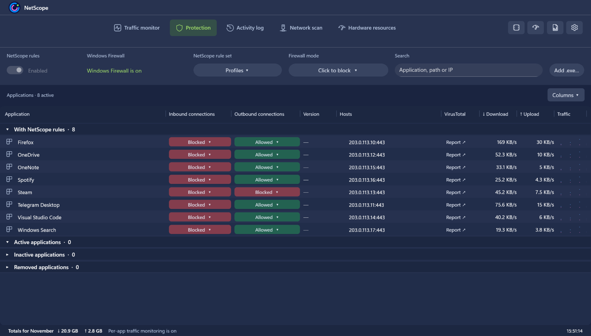
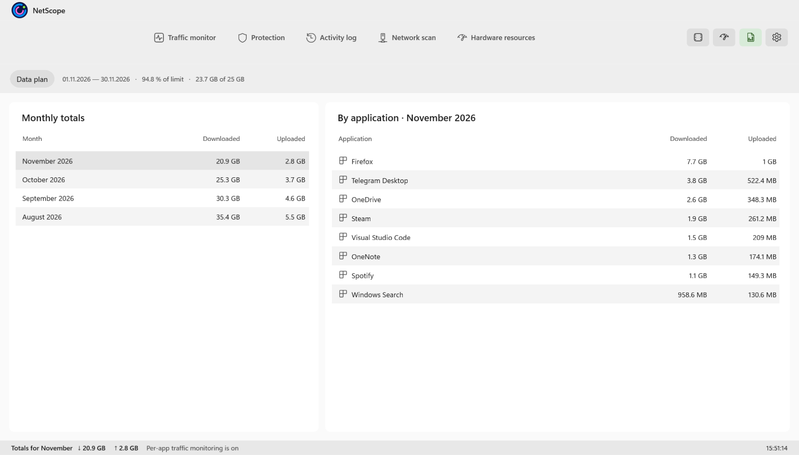
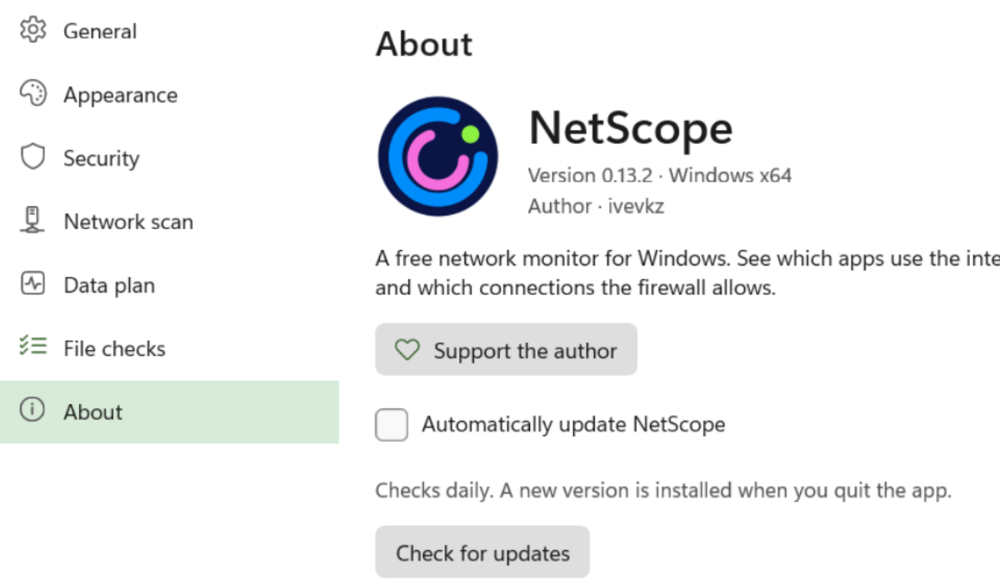

# NetScope

Бесплатный сетевой монитор для Windows x64. Показывает трафик каждой программы, ведёт месячные отчёты и позволяет управлять входящими и исходящими соединениями через брандмауэр Windows.

**[Скачать NetScope для Windows x64](https://github.com/ivevkz/NetScope/releases/latest/download/NetScope-Setup-x64.exe)** · [Все выпуски](https://github.com/ivevkz/NetScope/releases)

Для запуска нужны Windows 10 версии 2004 или новее, [.NET 10 Runtime x64](https://dotnet.microsoft.com/download/dotnet/10.0) и [Windows App Runtime 2 x64](https://learn.microsoft.com/windows/apps/windows-app-sdk/downloads). Для учёта трафика и управления брандмауэром NetScope запрашивает права администратора.

Закрытие окна сворачивает монитор в трей. Через правую кнопку на значке откройте **О программе**, чтобы узнать версию и проверить обновления. По умолчанию NetScope проверяет выпуски в фоне и устанавливает подписанное обновление при выходе через меню трея. Автообновление можно отключить в этом же разделе.

**Автор** · [ivevkz](https://github.com/ivevkz)  
**Конфиденциальность** · [Русский](PRIVACY.md) · [English](PRIVACY.en.md)

[Скриншоты английской версии](#screenshots)

## English

NetScope is a free Windows network monitor with per-app traffic graphs, monthly usage reports and Windows Firewall controls. The interface is available in English and Russian. Use **Settings → General → Display language** to switch.

[Download for Windows x64](https://github.com/ivevkz/NetScope/releases/latest/download/NetScope-Setup-x64.exe). Requires Windows 10 version 2004 or newer, .NET 10 Runtime x64 and Windows App Runtime 2 x64. Open **About** from the tray to check for updates or control automatic installation on exit.

## Screenshots

Captured in the English interface using demo traffic and application data.

### Traffic monitor

### Protection

### Monthly reports

### About

