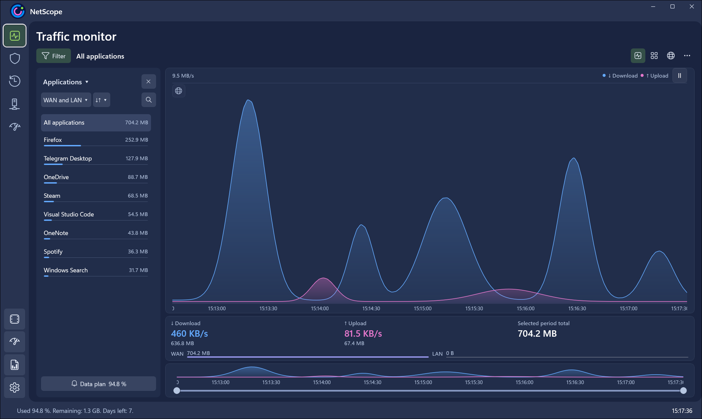
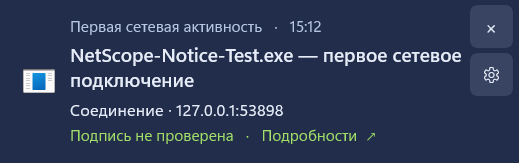

# NetScope

Бесплатный сетевой монитор для Windows x64. Показывает трафик каждой программы, ведёт месячные отчёты и позволяет управлять входящими и исходящими соединениями через брандмауэр Windows.

**[Скачать NetScope для Windows x64](https://github.com/ivevkz/NetScope/releases/latest/download/NetScope-Setup-x64.exe)** · [Все выпуски](https://github.com/ivevkz/NetScope/releases)

Для запуска нужна Windows x64: Windows 10 версии 2004 (сборка 19041) или новее, включая Windows 11. Начиная с версии 0.13.4 установщик содержит .NET 10 и Windows App Runtime 2. После скачивания установку можно выполнить без интернета. Начиная с версии 0.14.0 установщик регистрирует службу NetScope Monitor. Она ведёт учёт трафика и применяет правила брандмауэра для пользователя, которому установили программу. Окно и автозагрузка работают без запроса UAC.

Закрытие окна сворачивает монитор в трей. Через правую кнопку на значке откройте **О программе**, чтобы узнать версию и проверить обновления. По умолчанию NetScope проверяет выпуски в фоне и устанавливает подписанное обновление при выходе через меню трея. Автообновление можно отключить в этом же разделе.

В 0.15.0 в меню правила доступны временные блокировки. Если у программы сменился путь, NetScope предлагает перенести постоянную блокировку после сверки подписей. В тарифном плане можно выбрать адаптер и порог раннего предупреждения. При удалении программы отдельно выбираются очистка правил и удаление пользовательской истории.

**Автор** · [ivevkz](https://github.com/ivevkz)  
**Конфиденциальность** · [Русский](PRIVACY.md) · [English](PRIVACY.en.md)

[Скриншоты NetScope](#screenshots)

## English

NetScope is a free Windows network monitor with per-app traffic graphs, monthly usage reports and Windows Firewall controls. The interface is available in English and Russian. Use **Settings → General → Display language** to switch.

[Download for Windows x64](https://github.com/ivevkz/NetScope/releases/latest/download/NetScope-Setup-x64.exe). Requires Windows 10 version 2004 (build 19041) or later, including Windows 11. Starting with 0.13.4, the installer bundles .NET 10 and Windows App Runtime 2 and works offline once downloaded. Since 0.14.0, Setup installs the NetScope Monitor service for traffic accounting and firewall changes. The desktop app and sign-in shortcut run with normal user privileges. Open **About** from the tray to check for updates or control automatic installation on exit.

Version 0.15.0 adds expiring block rules, confirmed block transfers for signed updates, adapter-specific billing, early quota warnings and uninstall cleanup options.

## Screenshots

Screenshots from NetScope 0.17.1. The main window uses the English interface and demo traffic. The tray notification was captured in Russian during a local connection test.

### Traffic monitor

### Protection

### Monthly reports

### About

### Tray notification

